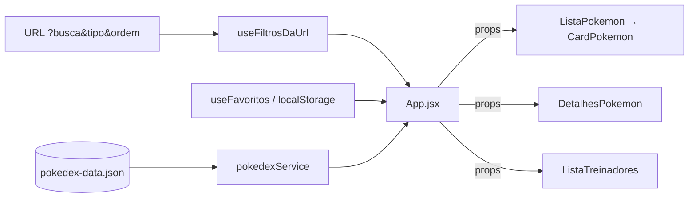

# ⚡ Pokédex React 🐾

> [!NOTE]
> Pokédex interativa feita com **React + Vite** para pesquisar, filtrar e explorar os 151 Pokémon da 1ª geração, seus atributos e os treinadores que os possuem — tudo a partir de um arquivo JSON local, sem back-end.

<table>
  <tr>
    <td width="800px">
      <div align="justify">
        Projeto da <b>Atividade 03</b> da disciplina <i>Desenvolvimento e Integração de Aplicações Web</i>, desenvolvido em dupla com <b>Pair Programming</b>. A aplicação demonstra <b>componentização</b>, <b>props</b>, <b>estado</b>, <b>eventos</b>, <b>renderização de listas</b>, <b>filtros e pesquisa</b> e <b>organização de projetos front-end</b>, com interface responsiva, modo escuro e identidade visual própria.
      </div>
    </td>
    <td>
      
    </td>
  </tr>
</table>

---

## 🚧 Status do Projeto

    

---

## 📚 Índice
- [Links Úteis](#-links-úteis)
- [Sobre o Projeto](#-sobre-o-projeto)
- [Funcionalidades Principais](#-funcionalidades-principais)
- [Tecnologias Utilizadas](#-tecnologias-utilizadas)
- [Arquitetura](#-arquitetura)
- [Instalação e Execução](#-instalação-e-execução)
  - [Pré-requisitos](#pré-requisitos)
  - [Variáveis de Ambiente](#-variáveis-de-ambiente)
  - [Instalação de Dependências](#-instalação-de-dependências)
  - [Como Executar a Aplicação](#-como-executar-a-aplicação)
- [Deploy](#-deploy)
- [Estrutura de Pastas](#-estrutura-de-pastas)
- [Demonstração](#-demonstração)
- [Testes](#-testes)
- [Documentações utilizadas](#-documentações-utilizadas)
- [Autores](#-autores)
- [Contribuição](#-contribuição)
- [Agradecimentos](#-agradecimentos)
- [Licença](#-licença)

---

## 🔗 Links Úteis
* 🌐 **Demo Online:** _não publicada_ (a aplicação pode ser hospedada na Vercel ou Netlify — veja [Deploy](#-deploy)).
* 📖 **Documentação:** este README.
* 📦 **Dados:** [`src/data/pokedex-data.json`](src/data/pokedex-data.json).

---

## 📝 Sobre o Projeto

A Pokédex nasceu como atividade acadêmica para praticar os conceitos fundamentais de **React** em um problema familiar: consultar Pokémon. Em vez de apenas listar dados, a proposta é entregar uma interface interativa em que o usuário **pesquisa**, **filtra por tipo**, **compara atributos visualmente** e **descobre quais Pokémon cada treinador possui**.

- **Por que existe:** consolidar React, Vite, props, estado e eventos de forma prática e divertida.
- **Qual problema resolve:** transforma um JSON extenso (151 Pokémon, 18 tipos, 12 treinadores) em uma consulta rápida e visual.
- **Contexto:** acadêmico, realizado em dupla com Pair Programming.
- **Onde pode ser usado:** como base para estudo de componentização, filtros e estados derivados em React.

---

## ✨ Funcionalidades Principais

- 🐾 **Pokédex:** cards com ID, nome, tipos e os seis atributos (HP, Attack, Defense, Special Attack, Special Defense, Speed).
- 🔎 **Pesquisa em tempo real:** por **nome** ou **ID** (aceita `#25`).
- 🧬 **Filtro por tipo:** botões coloridos gerados a partir dos tipos do JSON.
- 📄 **Detalhes do Pokémon:** modal com barras de atributos, total e navegação anterior/próximo (botões ou setas do teclado; `Esc` fecha).
- 🧑‍🚀 **Treinadores:** nome, insígnias e Pokémon de cada treinador (clique abre os detalhes).
- ⚠️ **Estado vazio:** mensagem amigável quando nenhum Pokémon é encontrado.
- 🔗 **Filtros na URL:** `?busca=pika&tipo=5&ordem=speed` — dá para copiar o link, recarregar e usar o botão "voltar".
- ⭐ **Favoritos:** salvos no `localStorage`, com filtro "apenas favoritos".
- 📊 **Ordenação:** por ID, nome ou qualquer atributo.
- 🎲 **Pokémon aleatório** e 🌙 **modo escuro**.
- 📱 **Layout responsivo** (desktop, tablet e smartphone).

---

## 🛠 Tecnologias Utilizadas

### 💻 Front-end

* **Framework/Biblioteca:** React 19 (componentes funcionais e Hooks)
* **Linguagem:** JavaScript ES6+ (JSX)
* **Estilização:** CSS puro, um arquivo por componente, com variáveis CSS para o tema claro/escuro
* **Gerenciamento de Estado:** `useState`, `useMemo`, `useCallback`, `useEffect` e Hooks próprios
* **Build Tool:** Vite 8
* **Qualidade de código:** oxlint

### 🖥️ Back-end

* Não há back-end. Os dados vêm do arquivo JSON local fornecido na atividade.

### ⚙️ Infraestrutura & Dados externos

* **Imagens:** sprites oficiais da [PokéAPI](https://github.com/PokeAPI/sprites) (uso opcional, conforme o enunciado). A aplicação continua funcionando sem imagens.
* **Hospedagem sugerida:** Vercel ou Netlify (arquivos estáticos).

---

## 🏗 Arquitetura

A aplicação é uma **SPA (Single Page Application)** em camadas simples, sem back-end:

- **Componentes (`components/`):** apenas interface; recebem dados e funções por **props**.
- **Hooks (`hooks/`):** lógica de estado reutilizável (filtros na URL, favoritos, tema).
- **Services (`services/`):** regras de negócio e acesso aos dados (filtrar, ordenar, resolver treinadores).
- **Config (`config/`):** constantes (cores dos tipos, atributos, opções de ordenação).
- **Dados (`data/`):** `pokedex-data.json`.

**Decisões importantes:**
- O estado dos filtros fica **na URL** (padrão adotado nos projetos da disciplina), o que permite compartilhar buscas.
- A lista exibida é um **estado derivado** (`useMemo`): não é guardada, é recalculada a partir dos filtros.
- O `App.jsx` concentra o estado e passa tudo por props ("state lifting"), mantendo os componentes simples e reutilizáveis.

**Fluxo de dados:**



**Trade-offs:** como todos os dados são carregados no navegador e filtrados em memória, a solução é ótima para 151 Pokémon, mas não escalaria para milhares de registros sem paginação ou uma API.

---

## 🔧 Instalação e Execução

### Pré-requisitos

* **Node.js:** versão LTS (v20.19 ou superior recomendada, exigência do Vite 8)
* **Gerenciador de Pacotes:** npm ou yarn

---

### 🔑 Variáveis de Ambiente

Este projeto **não utiliza variáveis de ambiente**: não há chaves de API nem back-end.

---

### 📦 Instalação de Dependências

```bash
git clone <URL_DO_SEU_REPOSITÓRIO>
cd pokedex-react
npm install
# ou
yarn install
```

---

### ⚡ Como Executar a Aplicação

```bash
npm run dev
# ou
yarn dev
```

🎨 *A aplicação estará disponível em **http://localhost:5173** (ou na porta indicada pelo Vite no terminal).*

---

## 🚀 Deploy

1. **Build do Projeto:** gera a pasta `dist/` com arquivos estáticos.

```bash
npm run build
```

2. **Pré-visualizar o build localmente:**

```bash
npm run preview
# ou
npm install -g serve
serve -s dist
```

3. **Hospedagem:** envie o repositório para a Vercel ou Netlify (preset **Vite**; comando `npm run build`; pasta de saída `dist`). Não é necessário configurar variáveis de ambiente.

---

## 📂 Estrutura de Pastas

```
.
├── .gitignore                    # 🧹 Ignora node_modules e dist.
├── README.md                     # 📘 Documentação principal do projeto.
├── LICENSE                       # ⚖️ Licença MIT.
├── CONTRIBUTING.md               # 🤝 Guia de contribuição.
├── index.html                    # 🌐 Página base da SPA.
├── package.json                  # 📦 Dependências e scripts.
├── vite.config.js                # ⚡ Configuração do Vite.
├── /public                       # 📂 Arquivos estáticos.
└── /src                          # 📂 Código-fonte React
    ├── main.jsx                  # 🚀 Ponto de entrada.
    ├── App.jsx / App.css         # 🧠 Estado principal e layout.
    ├── index.css                 # 🎨 Variáveis de tema e estilos globais.
    ├── /components               # 🧱 Componentes (cada pasta com .jsx e .css)
    │   ├── /Cabecalho            #    Título, troca de tela e tema.
    │   ├── /BarraBusca           #    Pesquisa por nome ou ID.
    │   ├── /FiltroTipos          #    Botões de filtro por tipo.
    │   ├── /ListaPokemon         #    Grade de cards + estado vazio.
    │   ├── /CardPokemon          #    Card de um Pokémon.
    │   ├── /DetalhesPokemon      #    Modal de detalhes.
    │   ├── /BarraAtributo        #    Barra de progresso de atributo.
    │   ├── /EtiquetaTipo         #    Etiqueta colorida do tipo.
    │   └── /ListaTreinadores     #    Treinadores e seus Pokémon.
    ├── /hooks                    # 🎣 useFiltrosDaUrl, useFavoritos, useTema.
    ├── /services                 # 🔌 pokedexService (filtros, ordenação, treinadores).
    ├── /config                   # 🔧 Cores dos tipos, atributos e ordenações.
    └── /data                     # 💾 pokedex-data.json
```

---

## 🎥 Demonstração

> Substitua os espaços abaixo por prints/GIFs da aplicação (hospede em `docs/` do repositório ou no GitHub Pages).

### 🌐 Aplicação Web

| Tela | Captura de Tela |
| :---: | :---: |
| **Pokédex (lista, pesquisa e filtro por tipo)** | _Sua imagem aqui_ |
| **Detalhes do Pokémon (modal)** | _Sua imagem aqui_ |
| **Treinadores** | _Sua imagem aqui_ |
| **Modo escuro** | _Sua imagem aqui_ |

---

## 🧪 Testes

O projeto não possui testes automatizados. A verificação é feita com análise estática e build:

```bash
npm run lint    # análise estática (oxlint)
npm run build   # garante que o projeto compila
```

**Roteiro de teste manual:**
1. Digitar `bulba` na busca → deve aparecer apenas Bulbasaur.
2. Digitar `25` → deve aparecer Pikachu.
3. Escolher o tipo **Fire** → só Pokémon do tipo Fire.
4. Digitar `xyz` → mensagem "Nenhum Pokémon encontrado".
5. Clicar em um card → modal com todos os atributos; testar `←`, `→` e `Esc`.
6. Abrir **Treinadores** → conferir nome, insígnias e Pokémon (ex.: Ash, 9 insígnias).
7. Favoritar um Pokémon, recarregar a página e conferir que continua favorito.

---

## 📖 Documentações utilizadas

- [React](https://react.dev/)
- [Vite](https://vite.dev/)
- [PokéAPI Sprites](https://github.com/PokeAPI/sprites) (imagens) e [PokéAPI](https://pokeapi.co/)
- [MDN Web Docs](https://developer.mozilla.org/) (History API, `localStorage`, CSS)
- Enunciado da Atividade 03 e projetos de exemplo do [Prof. Dr. João Paulo Aramuni](https://github.com/joaopauloaramuni)

---

## 👨‍💻 Autores

| Nome | GitHub |
| :--- | :--- |
| **Samuel Ferreira** | [@seu-usuario](https://github.com/seu-usuario) |
| **Crispim Bruno** | [@usuario-do-colega](https://github.com/usuario-do-colega) |

> Desenvolvido em dupla com a metodologia de **Pair Programming**.

---

## 🤝 Contribuição

Contribuições são bem-vindas! Veja o [CONTRIBUTING.md](CONTRIBUTING.md).

---

## 🙏 Agradecimentos

- Ao **Prof. Dr. João Paulo Aramuni**, pela atividade, pelos dados e pelos projetos de referência.
- À **PokéAPI** pelos sprites oficiais.
- Pokémon e seus nomes são marcas registradas de Nintendo, Game Freak e The Pokémon Company; este projeto é **apenas educacional**.

---

## ⚖️ Licença

Distribuído sob a licença **MIT**. Veja o arquivo [LICENSE](LICENSE).
