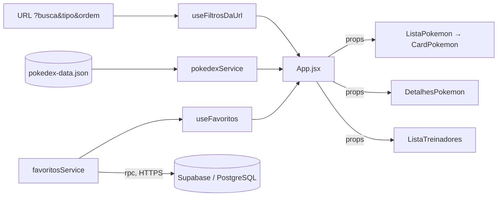
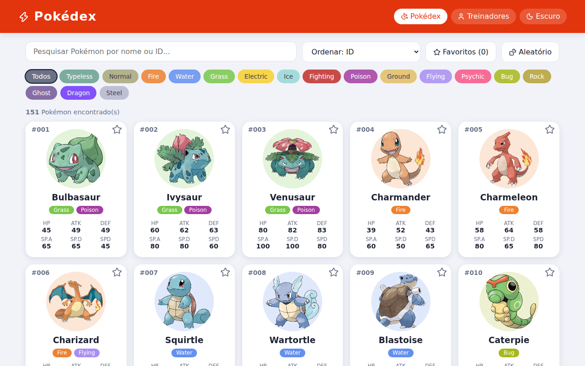
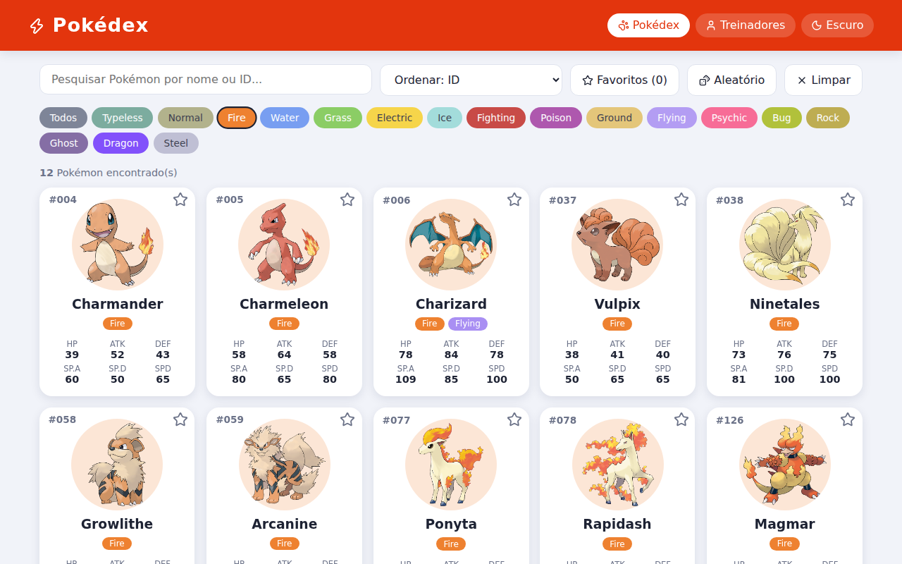
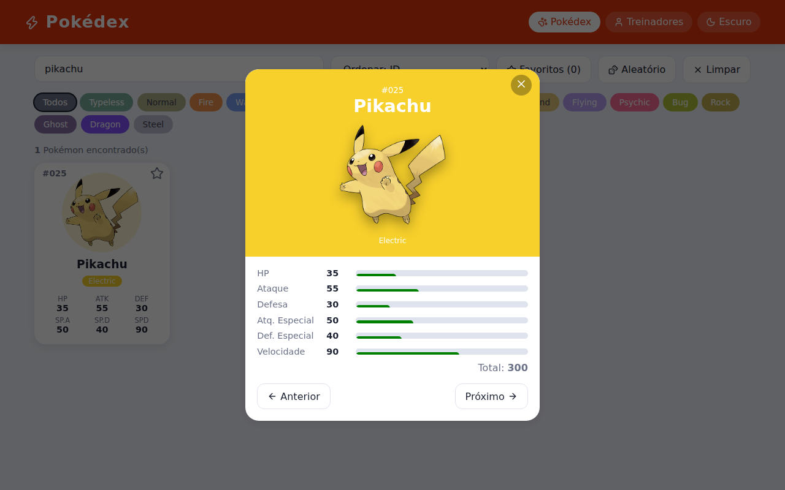
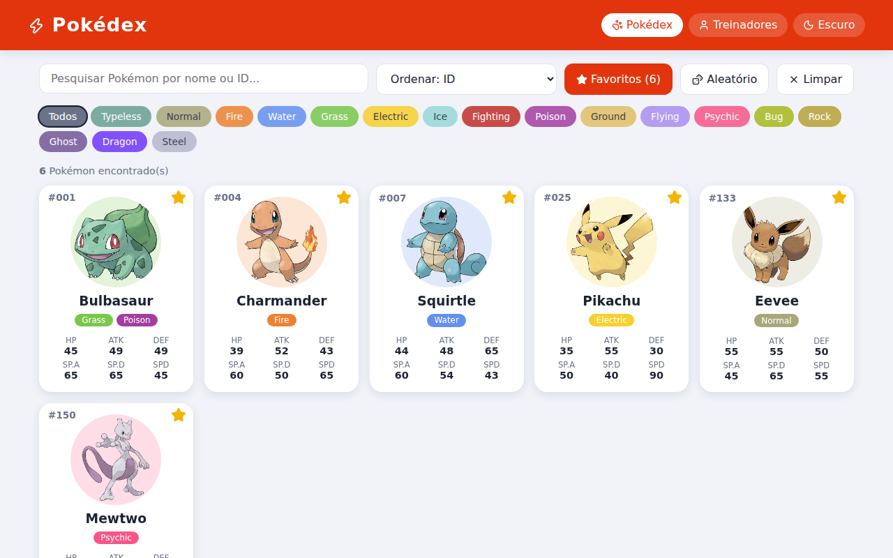
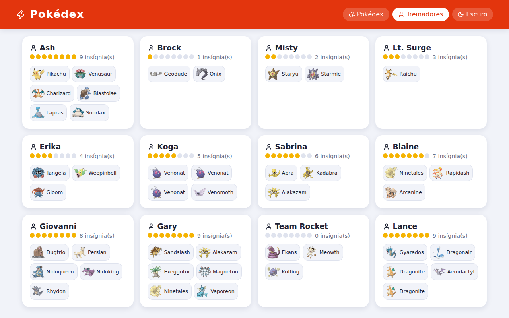
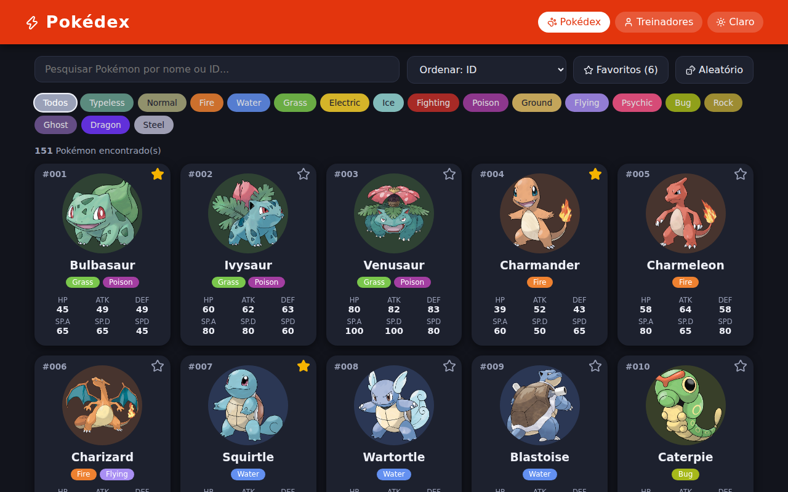
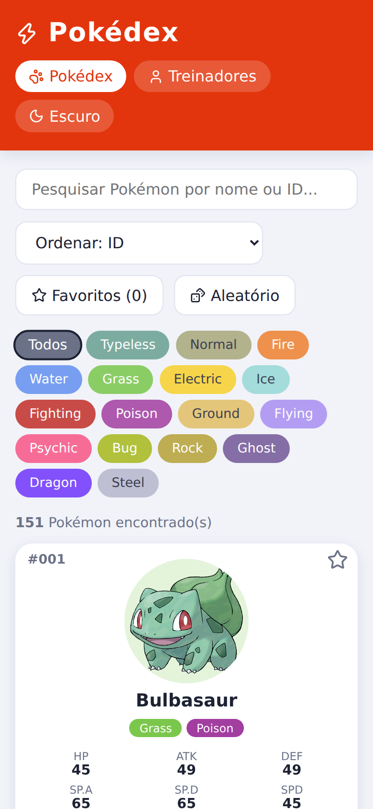

# ⚡ Pokédex React 🐾

> [!NOTE]
> Pokédex interativa feita com **React + Vite** para pesquisar, filtrar e explorar os 151 Pokémon da 1ª geração, seus atributos e os treinadores que os possuem. Os dados vêm de um arquivo JSON local e os **favoritos ficam salvos no Supabase** (PostgreSQL).

<table>
  <tr>
    <td width="800px">
      <div align="justify">
        Projeto da <b>Atividade 03</b> da disciplina <i>Desenvolvimento e Integração de Aplicações Web</i>, desenvolvido em dupla com <b>Pair Programming</b>. A aplicação demonstra <b>componentização</b>, <b>props</b>, <b>estado</b>, <b>eventos</b>, <b>renderização de listas</b>, <b>filtros e pesquisa</b> e <b>organização de projetos front-end</b>, com interface responsiva, modo escuro e identidade visual própria.
      </div>
    </td>
    <td>
      
    </td>
  </tr>
</table>

---

## 🚧 Status do Projeto

     

---

## 📚 Índice
- [Links Úteis](#-links-úteis)
- [Sobre o Projeto](#-sobre-o-projeto)
- [Funcionalidades Principais](#-funcionalidades-principais)
- [Tecnologias Utilizadas](#-tecnologias-utilizadas)
- [Arquitetura](#-arquitetura)
- [Instalação e Execução](#-instalação-e-execução)
  - [Pré-requisitos](#pré-requisitos)
  - [Variáveis de Ambiente](#-variáveis-de-ambiente)
  - [Configuração do Supabase (passo a passo)](#-configuração-do-supabase-passo-a-passo)
  - [Instalação de Dependências](#-instalação-de-dependências)
  - [Como Executar a Aplicação](#-como-executar-a-aplicação)
- [Deploy](#-deploy)
- [Estrutura de Pastas](#-estrutura-de-pastas)
- [Demonstração](#-demonstração)
- [Testes](#-testes)
- [Documentações utilizadas](#-documentações-utilizadas)
- [Autores](#-autores)
- [Contribuição](#-contribuição)
- [Agradecimentos](#-agradecimentos)
- [Licença](#-licença)

---

## 🔗 Links Úteis
* 🌐 **Demo Online:** _não publicada_ (a aplicação pode ser hospedada na Vercel ou Netlify — veja [Deploy](#-deploy)).
* 📖 **Documentação:** este README.
* 📦 **Dados:** [`src/data/pokedex-data.json`](src/data/pokedex-data.json).
* 🗄️ **Banco de dados dos favoritos:** [`supabase/favoritos.sql`](supabase/favoritos.sql) e o passo a passo em [Configuração do Supabase](#-configuração-do-supabase-passo-a-passo).

---

## 📝 Sobre o Projeto

A Pokédex nasceu como atividade acadêmica para praticar os conceitos fundamentais de **React** em um problema familiar: consultar Pokémon. Em vez de apenas listar dados, a proposta é entregar uma interface interativa em que o usuário **pesquisa**, **filtra por tipo**, **compara atributos visualmente** e **descobre quais Pokémon cada treinador possui**.

- **Por que existe:** consolidar React, Vite, props, estado e eventos de forma prática e divertida.
- **Qual problema resolve:** transforma um JSON extenso (151 Pokémon, 18 tipos, 12 treinadores) em uma consulta rápida e visual.
- **Contexto:** acadêmico, realizado em dupla com Pair Programming.
- **Onde pode ser usado:** como base para estudo de componentização, filtros e estados derivados em React.

---

## ✨ Funcionalidades Principais

- 🐾 **Pokédex:** cards com ID, nome, tipos e os seis atributos (HP, Attack, Defense, Special Attack, Special Defense, Speed).
- 🔎 **Pesquisa em tempo real:** por **nome** ou **ID** (aceita `#25`).
- 🧬 **Filtro por tipo:** botões coloridos gerados a partir dos tipos do JSON.
- 📄 **Detalhes do Pokémon:** modal com barras de atributos, total e navegação anterior/próximo (botões ou setas do teclado; `Esc` fecha).
- 🧑‍🚀 **Treinadores:** nome, insígnias e Pokémon de cada treinador (clique abre os detalhes).
- ⚠️ **Estado vazio:** mensagem amigável quando nenhum Pokémon é encontrado.
- 🔗 **Filtros na URL:** `?busca=pika&tipo=5&ordem=speed` — dá para copiar o link, recarregar e usar o botão "voltar".
- ⭐ **Favoritos no Supabase:** a estrela grava ou apaga o favorito no banco, e o botão **Favoritos** mostra só os marcados. Cada navegador tem os próprios favoritos, sem precisar de login. Sem o Supabase configurado, a Pokédex funciona normalmente e as estrelas ficam desativadas.
- 📊 **Ordenação:** por ID, nome ou qualquer atributo.
- 🎲 **Pokémon aleatório** e 🌙 **modo escuro**.
- 📱 **Layout responsivo** (desktop, tablet e smartphone).

---

## 🛠 Tecnologias Utilizadas

### 💻 Front-end

* **Framework/Biblioteca:** React 19 (componentes funcionais e Hooks)
* **Linguagem:** JavaScript ES6+ (JSX)
* **Estilização:** CSS puro, um arquivo por componente, com variáveis CSS para o tema claro/escuro
* **Ícones:** [lucide-react](https://lucide.dev/)
* **Gerenciamento de Estado:** `useState`, `useMemo`, `useCallback`, `useEffect`, `useRef` e Hooks próprios
* **Build Tool:** Vite 8
* **Qualidade de código:** ESLint (`npm run lint`) e oxlint (`npm run lint:oxlint`)

### 🖥️ Back-end

* Não há servidor próprio. Os dados dos Pokémon vêm do arquivo JSON local e os favoritos usam o **Supabase** como back-end pronto (BaaS).
* **Banco de Dados:** PostgreSQL, hospedado no Supabase
* **Acesso ao banco:** [`@supabase/supabase-js`](https://supabase.com/docs/reference/javascript/introduction), chamando funções SQL pela Data API (HTTPS)
* **Segurança:** RLS (Row Level Security) ligado e funções SQL como único caminho de acesso

### ⚙️ Infraestrutura & Dados externos

* **Imagens:** sprites oficiais da [PokéAPI](https://github.com/PokeAPI/sprites) (uso opcional, conforme o enunciado). A aplicação continua funcionando sem imagens.
* **Supabase:** conta gratuita em [supabase.com](https://supabase.com/).
* **Hospedagem sugerida:** Vercel ou Netlify (arquivos estáticos; veja as variáveis de ambiente em [Deploy](#-deploy)).

---

## 🏗 Arquitetura

A aplicação é uma **SPA (Single Page Application)** em camadas simples, que fala direto com o Supabase, sem servidor próprio:

- **Componentes (`components/`):** apenas interface; recebem dados e funções por **props**.
- **Hooks (`hooks/`):** lógica de estado reutilizável (filtros na URL, favoritos, tema).
- **Services (`services/`):** regras de negócio e acesso aos dados. `pokedexService` filtra, ordena e resolve treinadores; `favoritosService` conversa com o Supabase.
- **Lib (`lib/`):** o cliente do Supabase, criado uma vez só (e `null` quando o `.env.local` não está preenchido).
- **Utils (`utils/`):** `tokenDoNavegador`, que gera e guarda o identificador anônimo de cada navegador.
- **Config (`config/`):** constantes (cores dos tipos, atributos, opções de ordenação).
- **Dados (`data/`):** `pokedex-data.json`.

**Decisões importantes:**
- O estado dos filtros fica **na URL** (padrão adotado nos projetos da disciplina), o que permite compartilhar buscas.
- A lista exibida é um **estado derivado** (`useMemo`): não é guardada, é recalculada a partir dos filtros.
- O `App.jsx` concentra o estado e passa tudo por props ("state lifting"), mantendo os componentes simples e reutilizáveis.
- Os favoritos **não usam login**: cada navegador gera um `token` (UUID) na primeira visita e o guarda no `localStorage`. É esse token que separa os favoritos de cada pessoa na tabela.
- O navegador **não lê nem grava a tabela diretamente**. O RLS fica ligado e as permissões da tabela são removidas; o acesso é só pelas funções SQL `listar_favoritos` e `alternar_favorito`, que recebem o token. Assim ninguém consegue listar os favoritos dos outros, mesmo com a chave pública no JavaScript.
- Sem Supabase configurado, o app não quebra: o cliente não é criado e as estrelas ficam desativadas, com um aviso na tela.

**Fluxo de dados:**



**Trade-offs:** como todos os dados dos Pokémon são carregados no navegador e filtrados em memória, a solução é ótima para 151 Pokémon, mas não escalaria para milhares de registros sem paginação ou uma API. Como não há login, quem limpar os dados do navegador (ou trocar de aparelho) perde o acesso aos favoritos antigos.

---

## 🔧 Instalação e Execução

### Pré-requisitos

* **Node.js:** versão LTS (v20.19 ou superior recomendada, exigência do Vite 8)
* **Gerenciador de Pacotes:** npm ou yarn
* **Conta no Supabase** (gratuita), necessária só para os favoritos. Sem ela a Pokédex funciona, mas as estrelas ficam desativadas.

---

### 🔑 Variáveis de Ambiente

As variáveis ficam num arquivo **`.env.local`** na raiz do projeto (ele está no `.gitignore` e **não sobe para o GitHub**). O arquivo **`.env.example`** mostra quais variáveis existem.

```bash
cp .env.example .env.local
```

| Variável | Descrição | Exemplo |
| :--- | :--- | :--- |
| `VITE_SUPABASE_URL` | URL do seu projeto no Supabase. | `https://abcdefghijkl.supabase.co` |
| `VITE_SUPABASE_KEY` | Chave **publicável** (ou `anon`) do projeto. | `sb_publishable_...` |

> 💡 **Prefixo `VITE_`:** o Vite só expõe ao código do navegador as variáveis que começam com `VITE_`. Depois de criar ou mudar o `.env.local`, **reinicie o `npm run dev`**.

> ⛔ **Nunca use a `secret key` (`sb_secret_...`) nem a `service_role`.** Tudo que começa com `VITE_` vai para o JavaScript do navegador, onde qualquer visitante pode ler, e essas chaves **ignoram o RLS** e dão acesso total ao banco. A chave publicável é pública por natureza, e quem protege os dados é o RLS junto com as funções do `supabase/favoritos.sql`.

Se o `.env.local` não existir (ou ainda tiver os valores `COLE_...` do exemplo), a Pokédex abre normalmente, as estrelas ficam desativadas e aparece o aviso **"Favoritos desativados"**.

---

### 🗄 Configuração do Supabase (passo a passo)

Os favoritos ficam em uma tabela PostgreSQL no Supabase. Faça isto **uma vez**:

#### 1. Criar a conta e o projeto

1. Acesse [supabase.com](https://supabase.com/) e crie uma conta (dá para entrar com o GitHub).
2. No painel, clique em **New project**.
3. Preencha **Name** (ex.: `pokedex`), **Database Password** (crie uma senha e guarde; ela **não** vai para o `.env`) e **Region** (no Brasil, **South America (São Paulo)**; a região não pode ser trocada depois).
4. Clique em **Create new project** e espere o banco ficar pronto.

#### 2. Criar a tabela e as funções (obrigatório)

1. No menu lateral, abra o **SQL Editor** e clique em **New query**.
2. Cole todo o conteúdo do arquivo [`supabase/favoritos.sql`](supabase/favoritos.sql).
3. Clique em **Run**. O script pode ser executado de novo sem problema.

Ele cria:

| Objeto | O que faz |
| :--- | :--- |
| Tabela `favoritos` | Colunas `token`, `pokemon_id` e `criado_em`, com chave primária `(token, pokemon_id)` |
| `check` no `pokemon_id` | Aceita só IDs de **1 a 151** |
| RLS ligado + `revoke all` | O navegador **não** lê, insere, altera nem apaga a tabela direto |
| Função `listar_favoritos` | Devolve os favoritos de **um** token |
| Função `alternar_favorito` | Se já é favorito, apaga e devolve `false`; senão, insere e devolve `true` |
| `grant execute` | Libera só essas duas funções para quem usa a chave pública |
| `notify pgrst` | Atualiza o cache da API para ela enxergar as funções na hora |

#### 3. Copiar a URL e a chave publicável

1. Em **Project Settings → Data API**, copie a **Project URL** (`https://<seu-projeto>.supabase.co`).
2. Em **Project Settings → API Keys**, copie a **Publishable key** (`sb_publishable_...`). A chave `anon` (legacy) funciona do mesmo jeito.

Os dois também aparecem no botão **Connect**, na barra superior do projeto.

#### 4. Preencher o `.env.local`

Crie o arquivo a partir do exemplo e cole os valores:

```bash
cp .env.example .env.local
```

```properties
VITE_SUPABASE_URL=https://abcdefghijkl.supabase.co
VITE_SUPABASE_KEY=sb_publishable_xxxxxxxxxxxxxxxxxxxx
```

#### 5. Conferir se funcionou

1. Instale as dependências ([próxima seção](#-instalação-de-dependências)), rode `npm run dev` e favorite 2 ou 3 Pokémon.
2. Recarregue a página (F5): as estrelas devem continuar marcadas.
3. No Supabase, abra **Table Editor → favoritos**: as linhas devem aparecer lá.

#### Problemas comuns

| Sintoma | Causa provável | Como resolver |
| :--- | :--- | :--- |
| Aviso **"Favoritos desativados"** | `.env.local` não existe, tem valores de exemplo ou o servidor não foi reiniciado | Preencha o arquivo e reinicie o `npm run dev` |
| Erro `Could not find the function ... in the schema cache` | O SQL não foi executado ou o cache da API está antigo | Rode o `supabase/favoritos.sql` de novo (ele atualiza o cache) |
| Erro `permission denied` ou `401` | Chave errada, ou uma `secret key` colada no lugar da publicável | Copie de novo a **Publishable key** |
| A estrela marca, mas some ao recarregar | Erro ao salvar (veja a mensagem na tela e o console, `F12`) | Confira a URL, a chave e se o SQL foi executado |
| Favoritos sumiram | O `localStorage` do navegador foi limpo (o token mudou) ou é outro navegador | Esperado: não há login, então cada navegador tem os seus favoritos |

---

### 📦 Instalação de Dependências

```bash
git clone <URL_DO_SEU_REPOSITÓRIO>
cd pokedex-react
npm install
# ou
yarn install
```

---

### ⚡ Como Executar a Aplicação

```bash
npm run dev
# ou
yarn dev
```

🎨 *A aplicação estará disponível em **http://localhost:5173** (ou na porta indicada pelo Vite no terminal).*

---

## 🚀 Deploy

1. **Build do Projeto:** gera a pasta `dist/` com arquivos estáticos.

```bash
npm run build
```

2. **Pré-visualizar o build localmente:**

```bash
npm run preview
# ou
npm install -g serve
serve -s dist
```

3. **Hospedagem:** envie o repositório para a Vercel ou Netlify (preset **Vite**; comando `npm run build`; pasta de saída `dist`).

4. **Variáveis de ambiente:** no painel do provedor (na Vercel: *Project Settings → Environment Variables*), crie `VITE_SUPABASE_URL` e `VITE_SUPABASE_KEY` com os mesmos valores do `.env.local`.

> 🔑 O Vite grava essas variáveis no JavaScript **durante o build**. Se você criar ou mudar as variáveis depois de publicar, faça um **novo deploy** para elas valerem. Use sempre a chave **publicável**, nunca a `secret key` nem a `service_role`.

---

## 📂 Estrutura de Pastas

```
.
├── .env.example                  # 🧩 Variáveis necessárias (sem valores reais). Copie para .env.local.
├── .env.local                    # 🔒 Suas chaves do Supabase (não versionado).
├── .gitignore                    # 🧹 Ignora node_modules, dist, .env e .env.local.
├── README.md                     # 📘 Documentação principal do projeto.
├── LICENSE                       # ⚖️ Licença MIT.
├── CONTRIBUTING.md               # 🤝 Guia de contribuição.
├── index.html                    # 🌐 Página base da SPA.
├── package.json                  # 📦 Dependências e scripts.
├── eslint.config.js              # ✨ Regras do ESLint.
├── /supabase                     # 🗄️ Banco de dados
│   └── favoritos.sql             #    Tabela, RLS e funções dos favoritos (rode no SQL Editor).
├── vite.config.js                # ⚡ Configuração do Vite.
├── /public                       # 📂 Arquivos estáticos.
├── /docs                         # 🖼️ Capturas de tela usadas neste README.
└── /src                          # 📂 Código-fonte React
    ├── main.jsx                  # 🚀 Ponto de entrada.
    ├── App.jsx / App.css         # 🧠 Estado principal e layout.
    ├── index.css                 # 🎨 Variáveis de tema e estilos globais.
    ├── /components               # 🧱 Componentes (cada pasta com .jsx e .css)
    │   ├── /Cabecalho            #    Título, troca de tela e tema.
    │   ├── /BarraBusca           #    Pesquisa por nome ou ID.
    │   ├── /FiltroTipos          #    Botões de filtro por tipo.
    │   ├── /ListaPokemon         #    Grade de cards + estado vazio.
    │   ├── /CardPokemon          #    Card de um Pokémon.
    │   ├── /DetalhesPokemon      #    Modal de detalhes.
    │   ├── /BarraAtributo        #    Barra de progresso de atributo.
    │   ├── /EtiquetaTipo         #    Etiqueta colorida do tipo.
    │   └── /ListaTreinadores     #    Treinadores e seus Pokémon.
    ├── /hooks                    # 🎣 useFiltrosDaUrl, useFavoritos, useTema.
    ├── /services                 # 🔌 pokedexService (filtros, ordenação, treinadores) e favoritosService (Supabase).
    ├── /lib                      # 🔗 supabase.js (cliente do Supabase).
    ├── /utils                    # 🛠️ tokenDoNavegador.js (identificador anônimo do navegador).
    ├── /config                   # 🔧 Cores dos tipos, atributos e ordenações.
    └── /data                     # 💾 pokedex-data.json
```

---

## 🎥 Demonstração

### 🌐 Aplicação Web

| Pokédex (lista e pesquisa) | Filtro por tipo |
| :---: | :---: |
|  |  |

| Detalhes do Pokémon | Favoritos (Supabase) |
| :---: | :---: |
|  |  |

| Treinadores | Modo escuro |
| :---: | :---: |
|  |  |

### 📱 Celular



---

## 🧪 Testes

O projeto não possui testes automatizados. A verificação é feita com análise estática e build:

```bash
npm run lint          # análise estática (ESLint)
npm run lint:oxlint   # análise estática (oxlint)
npm run build         # garante que o projeto compila
```

**Roteiro de teste manual:**
1. Digitar `bulba` na busca → deve aparecer apenas Bulbasaur.
2. Digitar `25` → deve aparecer Pikachu.
3. Escolher o tipo **Fire** → só Pokémon do tipo Fire.
4. Digitar `xyz` → mensagem "Nenhum Pokémon encontrado".
5. Clicar em um card → modal com todos os atributos; testar `←`, `→` e `Esc`.
6. Abrir **Treinadores** → conferir nome, insígnias e Pokémon (ex.: Ash, 9 insígnias).
7. Com o Supabase configurado: favoritar um Pokémon, recarregar a página e conferir que continua favorito (e que a linha aparece em **Table Editor → favoritos**).
8. Sem o `.env.local`: a Pokédex abre, aparece o aviso "Favoritos desativados" e as estrelas não respondem.

---

## 📖 Documentações utilizadas

- [React](https://react.dev/)
- [Vite](https://vite.dev/)
- [Supabase](https://supabase.com/docs), [supabase-js](https://supabase.com/docs/reference/javascript/introduction), [funções com `rpc`](https://supabase.com/docs/reference/javascript/rpc) e [Row Level Security](https://supabase.com/docs/guides/database/postgres/row-level-security)
- [lucide-react](https://lucide.dev/guide/packages/lucide-react) (ícones)
- [PokéAPI Sprites](https://github.com/PokeAPI/sprites) (imagens) e [PokéAPI](https://pokeapi.co/)
- [MDN Web Docs](https://developer.mozilla.org/) (History API, `localStorage`, CSS)
- Enunciado da Atividade 03 e projetos de exemplo do [Prof. Dr. João Paulo Aramuni](https://github.com/joaopauloaramuni)

---

## 👨‍💻 Autores

| Nome | GitHub |
| :--- | :--- |
| **Samuel Ferreira** | [@SamuelFerr0](https://github.com/SamuelFerr0) |
| **Crispim Bruno** | [@usuario-do-colega](https://github.com/usuario-do-colega) |

> Desenvolvido em dupla com a metodologia de **Pair Programming**.

---

## 🤝 Contribuição

Contribuições são bem-vindas! Veja o [CONTRIBUTING.md](CONTRIBUTING.md).

---

## 🙏 Agradecimentos

- Ao **Prof. Dr. João Paulo Aramuni**, pela atividade, pelos dados e pelos projetos de referência.
- À **PokéAPI** pelos sprites oficiais.
- Pokémon e seus nomes são marcas registradas de Nintendo, Game Freak e The Pokémon Company; este projeto é **apenas educacional**.

---

## ⚖️ Licença

Distribuído sob a licença **MIT**. Veja o arquivo [LICENSE](LICENSE).
